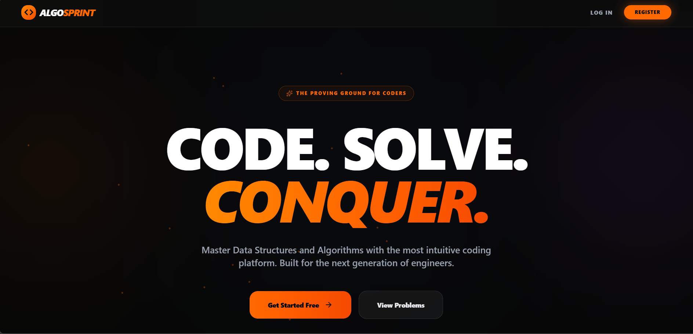
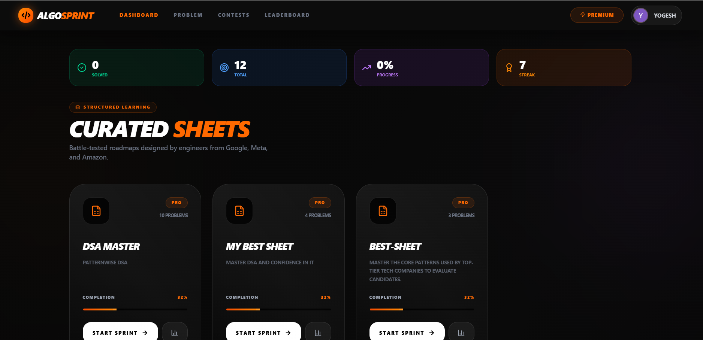
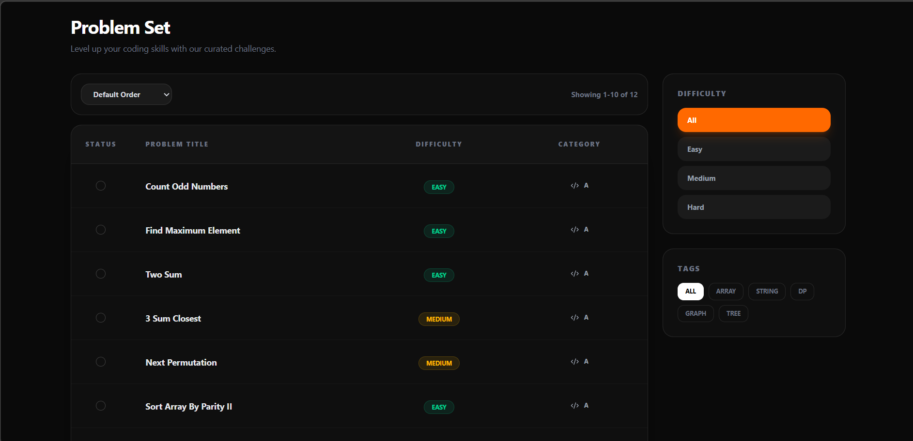
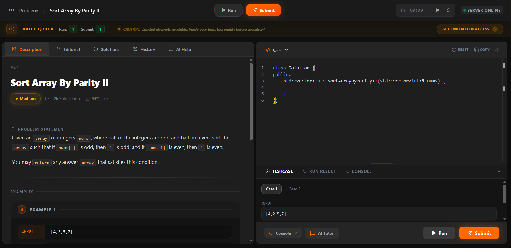
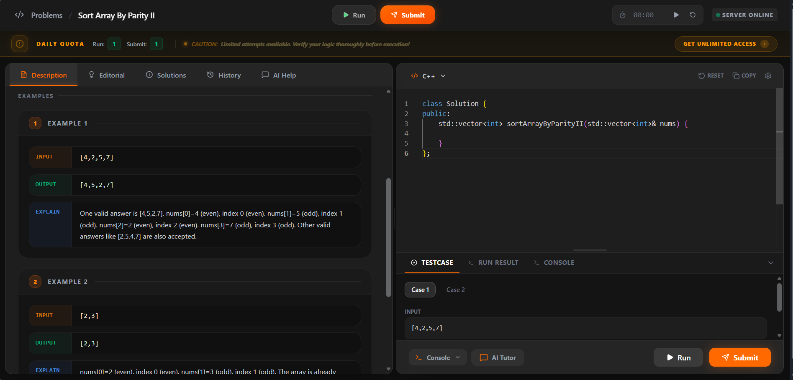
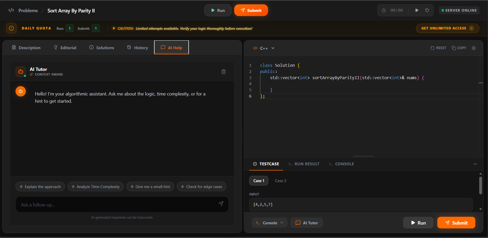

# AlgoSprint — Competitive Coding Platform

<div align="center">



[](https://algo-sprint-iota.vercel.app)
[](https://algosprint-p1wd.onrender.com)
[](LICENSE)

**A full-stack competitive programming platform with real code execution, AI-powered reviews, and a judge system.**

[🌐 Live Demo](https://algo-sprint-iota.vercel.app)
 <!-- [🐛 Report Bug](https://github.com/username/algosprint/issues) · [✨ Request Feature](https://github.com/username/algosprint/issues) -->

</div>

---

## 📸 Screenshots

| Problem Page | Mobile View | AI Review |
|---|---|---|
|  |  |  |  |  |

---

## ✨ Features

- 🏃 **Real Code Execution** — Powered by Judge0 API (C++, Java, JavaScript)
- 🤖 **AI Code Review** — Gemini AI analyzes your code when daily quota is exhausted
- ⚡ **Local Syntax Checker** — Instant syntax validation before hitting Judge0 (saves API quota)
- 📱 **Fully Responsive** — Dedicated mobile layout with bottom navigation
- 🔐 **Auth System** — JWT + Google OAuth2 login
- ⏱️ **Problem Timer** — Track time spent per problem
- 📊 **Submission History** — View all past submissions per problem
- 🎨 **Monaco Editor** — VS Code-style editor with syntax highlighting
- 💬 **AI Tutor Chat** — Ask questions about the problem
- 📹 **Editorial Videos** — Video solutions via Cloudinary
- 🔒 **Daily Quota System** — Run/Submit limits with AI fallback
- 🏆 **Difficulty Ratings** — Easy / Medium / Hard with status tracking

---

## 🛠️ Tech Stack

### Frontend
| Tech | Usage |
|---|---|
| React 18 | UI framework |
| Redux Toolkit | Global state (editor code, language) |
| Monaco Editor | VS Code-style code editor |
| Tailwind CSS | Styling |
| Vite | Build tool |
| Vercel | Deployment |

### Backend
| Tech | Usage |
|---|---|
| Node.js + Express | REST API |
| MongoDB + Mongoose | Database | Resend
| Redis | Session / caching |
| Judge0 (RapidAPI) | Real code execution |
| Gemini AI | AI code review |
| Cloudinary | Video storage |
| JWT + Passport | Authentication |
| Render | Deployment |

---

## 🏗️ Project Structure

```
AlgoSprint/
    ├── backend/
    │   ├── src/
    │   │   ├── config/           # DB, Redis, Passport config
    │   │   ├── controllers/      # Route handlers
    │   │   ├── middleware/        # Auth, error middleware
    │   │   ├── models/           # Mongoose schemas
    │   │   ├── routes/           # Express routes
    │   │   ├── utils/            # Helper functions
    │   │   ├── .env
    │   │   └── index.js          # Entry point
    │   ├── .gitignore
    │   ├── Dockerfile
    │   ├── package.json
    │   └── vercel.json
    │
    ├── frontend/
    │   ├── src/
    │   │   ├── assets/           # Images, icons
    │   │   ├── components/       # Reusable UI components
    │   │   ├── hooks/            # Custom React hooks
    │   │   ├── lib/              # Utility libraries
    │   │   ├── pages/            # Page components
    │   │   ├── redux/            # Redux slices
    │   │   ├── store/            # Redux store config
    │   │   ├── utils/            # Helper functions
    │   │   ├── App.css
    │   │   ├── App.jsx
    │   │   ├── authSlice.js
    │   │   ├── index.css
    │   │   └── main.jsx
    │   ├── .env
    │   ├── .gitignore
    │   ├── index.html
    │   ├── package.json
    │   ├── vercel.json
    │   └── vite.config.js
    │
    ├── screenshots/              # App screenshots for README
    │   ├── banner.png
    │   ├── aihelp.png
    │   ├── codeeditor1.png
    │   ├── codeeditor2.png
    │   ├── dashboard1.png
    │   ├── dashboard2.png
    │   └── landingpage.png
    │
    ├── package.json
    └── README.md
```

---

## ⚙️ Local Setup

### Prerequisites
- Node.js 18+
- MongoDB
- Redis
- g++ (for local syntax checking)

### 1. Clone the repo
```bash
git clone https://github.com/username/algosprint.git
cd algosprint
```

### 2. Backend setup
```bash
cd backend
npm install
```

Create `backend/.env`:
```env
PORT=3000
MONGODB_URI=your_mongodb_uri
JWT_SECRET=your_jwt_secret
REDIS_URL=your_redis_url
RAPIDAPI_KEY=your_judge0_key
GEMINI_API_KEY=your_gemini_key
CLOUDINARY_CLOUD_NAME=your_cloudinary_name
CLOUDINARY_API_KEY=your_cloudinary_key
CLOUDINARY_API_SECRET=your_cloudinary_secret
GOOGLE_CLIENT_ID=your_google_client_id
GOOGLE_CLIENT_SECRET=your_google_client_secret
```

```bash
npm run dev
```

### 3. Frontend setup
```bash
cd frontend
npm install
```

Create `frontend/.env`:
```env
VITE_API_URL=http://localhost:3000
```

```bash
npm run dev
```

---

## 🚀 Deployment

| Service | Platform | URL |
|---|---|---|
| Frontend | Vercel | [algo-sprint-iota.vercel.app](https://algo-sprint-iota.vercel.app) |
| Backend | Render | [algosprint-p1wd.onrender.com](https://algosprint-p1wd.onrender.com) |
| Database | MongoDB Atlas | — |
| Cache | Redis Cloud | — |

---

## 🔑 Key Implementation Details

### Syntax Check Gate
Before every Judge0 call, code is checked locally using `g++ -fsyntax-only`. This:
- Catches missing semicolons, undeclared variables instantly (~100ms)
- Saves Judge0 API quota (free tier: 50 req/day)
- Handles LeetCode-style fragments by auto-prepending `#include <bits/stdc++.h>`
- Adjusts compiler line numbers back to user's original code

### AI Fallback System
When daily quota is exhausted:
1. User clicks Run/Submit
2. Backend detects quota = 0
3. Gemini AI reviews code statically
4. Terminal-style colored output shown to user

### Daily Quota System
- Each user gets N runs and N submits per problem per day
- Tracked in MongoDB with daily reset
- When exhausted → AI review mode activates automatically

---

## 📈 What I Learned Building This

- Integrating Judge0 API with base64 encoding, batch polling, and error handling
- Building a quota system with daily limits and AI fallback
- Handling LeetCode-style code fragments in a local compiler
- Fully responsive design with a separate dedicated mobile layout
- Real-time syntax checking with debouncing and AbortController
- Google OAuth2 + JWT hybrid authentication flow
- Deployment across Vercel (frontend) + Render (backend) + MongoDB Atlas

---

## 📄 License

MIT © [Yogesh](https://github.com/Yogesh-Nagrare)

---

<div align="center">
Made with ❤️ by <a href="https://github.com/Yogesh-Nagrare">Yogesh</a>
<br/><br/>
⭐ Star this repo if you found it helpful!
</div>